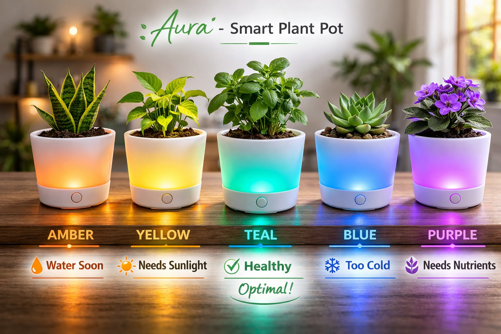
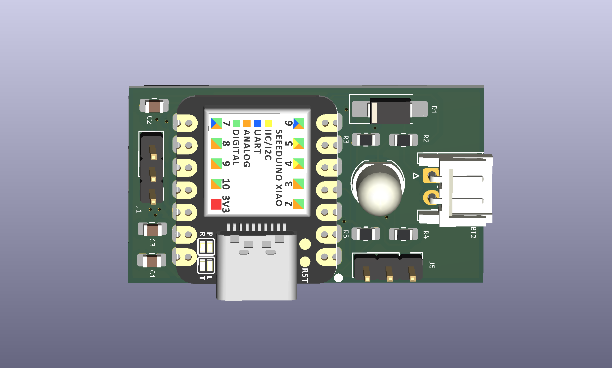

# Aura Smart Plant Pot 🌱


## Overview

It is a smart plant-care hardware platform designed to simplify plant maintenance through real-time visual feedback.

The PCB interfaces with a soil moisture sensor and uses a programmable RGB LED to indicate soil conditions through color codes. Powered by a battery and controlled by a Seeed Studio XIAO SAMD21, Aura is optimized for low-power operation and can be embedded into decorative plant pots, desktop planters, indoor gardens, or educational plant-monitoring systems.

Instead of requiring a mobile app or display, Aura communicates plant health using instantly recognizable colors, making plant care accessible and intuitive.

## Board Preview




## Features

✅ Soil Moisture Monitoring

✅ RGB Color-Based Status Indication

✅ Battery Powered Operation

✅ Power ON/OFF Switch

✅ Compact PCB Form Factor

✅ External Soil Moisture Sensor Interface

✅ Low Power Embedded Design

✅ USB-C Programming via XIAO SAMD21

## Color Indication Scheme

Aura uses color feedback to communicate the condition of the plant.

Color	Condition🔴 Red	Soil Extremely Dry
🟠 Amber	Water Required Soon
🟡 Yellow	Low Moisture Level
🟢 Green	Optimal Moisture
🔵 Blue	High Moisture
🟣 Purple	Sensor/Error/Future Status Extension

Threshold values can be customized in firmware according to plant type and soil characteristics.
The compact layout was designed to fit within smart planter enclosures while maintaining accessibility to programming and sensor connections.

## Applications
Indoor Plant Monitoring
Smart Flower Pots
Office Desk Plants
Educational IoT Projects
Sustainable Agriculture Demonstrations
Low-Power Sensor Platforms
Temperature Monitoring
Humidity Monitoring
Rechargeable Battery Management

---
 
## Getting Started
 
### View the Design
1. Install [KiCad](https://www.kicad.org/) (v7+ recommended)
2. Clone this repo:
```bash
   git clone https://github.com/Poornimakulkarni26/pocket-arcade.git
```
3. Open the `.kicad_pro` file in KiCad

---

## Author
 
**Poornima Kulkarni**
Embedded Systems & Industrial Automation Engineer
 
- GitHub: [@Poornimakulkarni26](https://github.com/Poornimakulkarni26)

---
## License
 
This project is open-source under the [MIT License](LICENSE).
